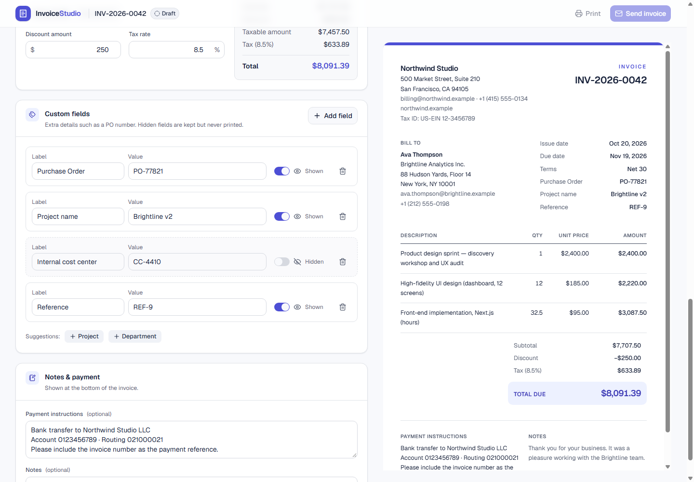

# Invoice Generator

A customizable, browser-based invoice generator: edit an invoice with a live preview, print or save
it as PDF, and email it through Resend. No database: the invoice lives in the browser tab (persistence
was descoped by the developer — see [docs/PROJECT_OVERVIEW.md](docs/PROJECT_OVERVIEW.md#scope-changes)).

> **Status:** complete within scope. Database / invoice list descoped by the developer; real
> Resend delivery pending a test with the developer's key. Details: [docs/phases/](docs/phases/).

## Features

- Editor with live preview; desktop split view, mobile Editor/Preview tabs
- Line items, fixed or % discount, tax — integer-cent engine, $99.00 example verified
- Custom fields with show / hide (hidden fields never printed or emailed)
- Print / Save as PDF (A4 print stylesheet, multi-page safe) — [sample PDF](docs/samples/invoice-sample.pdf)
- Email via Resend from a Server Action (validated, server-recalculated, rate-limited)



## Tech stack

Next.js 16 (App Router) · React 19 · TypeScript (strict) · Tailwind CSS v4 · shadcn/ui ·
Lucide React · React Hook Form · Zod 4 · Resend ·
Vitest · ESLint · Prettier

## Getting started

```bash
npm install
cp .env.example .env      # adjust values; never commit .env
npm run dev               # http://localhost:3000
```

Requires Node.js ≥ 20.19. Full details: [docs/ENVIRONMENT_SETUP.md](docs/ENVIRONMENT_SETUP.md).

## Scripts

| Command                       | Purpose                                 |
| ----------------------------- | --------------------------------------- |
| `npm run dev`                 | Development server                      |
| `npm run build` / `npm start` | Production build / serve                |
| `npm run typecheck`           | TypeScript check                        |
| `npm run lint`                | ESLint                                  |
| `npm test`                    | Unit tests (Vitest)                     |
| `npm run format`              | Prettier                                |
| `npm run e2e`                 | Browser checks (needs a running server) |
| `npm run check`               | typecheck + lint + test                 |

## Environment variables

| Variable         | Purpose                                                                                     |
| ---------------- | ------------------------------------------------------------------------------------------- |
| `RESEND_API_KEY` | Resend API key (server-side only)                                                           |
| `EMAIL_FROM`     | Sender; domain verified in Resend, or `onboarding@resend.dev` for tests to your own address |

See [.env.example](.env.example) and [docs/ENVIRONMENT_SETUP.md](docs/ENVIRONMENT_SETUP.md#setting-up-resend)
for step-by-step Resend setup. Without these variables the app works; only sending is disabled,
with an explanation in the Send dialog.

## Documentation

- [Documentation index](docs/README.md)
- [Architecture](docs/ARCHITECTURE.md) · [Calculation rules](docs/CALCULATION_RULES.md) ·
  [API](docs/API_DOCUMENTATION.md)
- [Testing](docs/TESTING.md) · [Deployment](docs/DEPLOYMENT.md) ·
  [Known limitations](docs/KNOWN_LIMITATIONS.md)
- [Git workflow](docs/GIT_WORKFLOW.md) · [AI usage](docs/AI_USAGE.md) · [Time log](docs/TIME_LOG.md)
- Phase prompts: [docs/prompts/](docs/prompts/) · Phase reports: [docs/phases/](docs/phases/)
